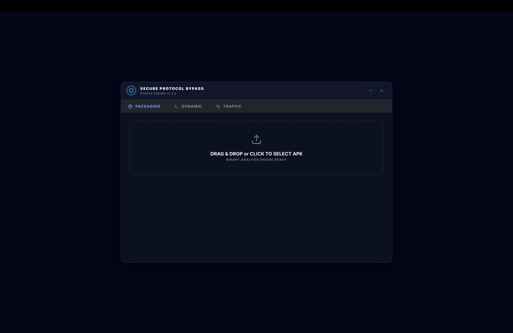
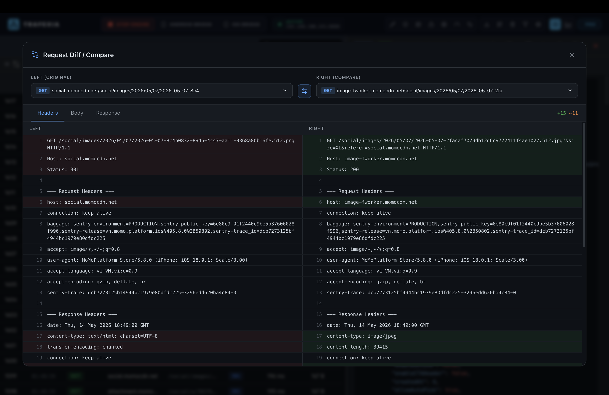
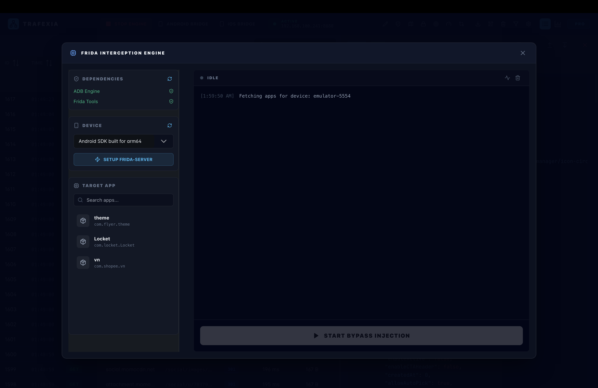
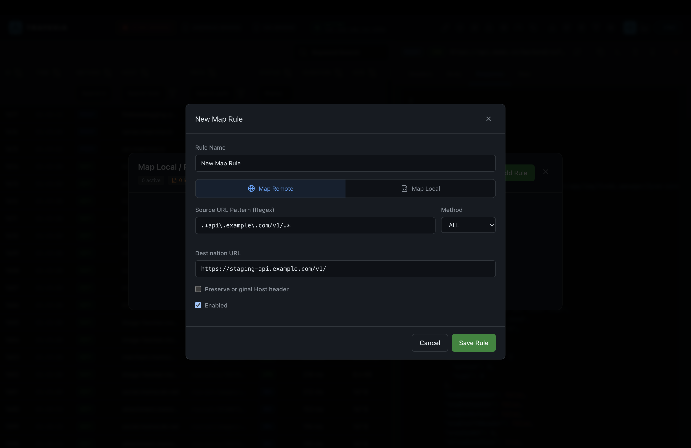
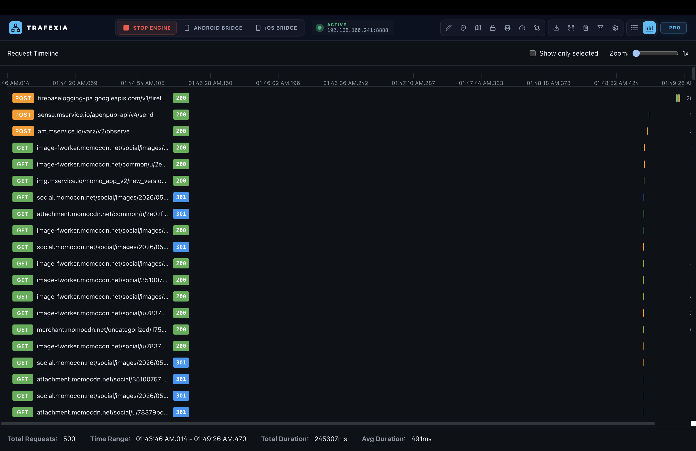

# Trafexia - Mobile Traffic Interceptor

🌍 **Translations**: [Tiếng Việt](README_VI.md) | [简体中文](README_ZH.md) | [日本語](README_JA.md) | [한국어](README_KO.md) | [Español](README_ES.md) | [Français](README_FR.md) | [Deutsch](README_DE.md) | [Русский](README_RU.md) | [Português](README_PT.md)

A powerful desktop application for intercepting, analyzing, and manipulating HTTP/HTTPS traffic from mobile devices. Built with Electron, Vue 3, and TypeScript.

Trafexia provides comprehensive tools for mobile app security testing, reverse engineering, and API debugging with advanced features like SSL pinning bypass, request mocking, traffic mapping, and more.

## ✨ Key Features

### 📊 Real-time Traffic Analysis
- **Live Request Capture** - Intercept and display HTTP/HTTPS requests in real-time
- **Request Timeline Visualization** - See request distribution and patterns over time
- **Advanced Filtering** - Filter by HTTP method, status code, host, URL path, and more
- **Request Comparison** - Side-by-side diff view to compare original vs. modified requests


*Real-time request capture with detailed headers, body, and response analysis*


*Visual timeline showing request distribution and frequency*


*Side-by-side request comparison with header and response diff*

---

### 🎯 Request Manipulation
- **Request Mapping** - Map requests to different URLs with regex pattern support
- **Mock Responses** - Create mock responses with custom status codes, headers, and bodies
- **Request Composer** - Build and test custom HTTP requests
- **Throttling Control** - Simulate network conditions and bandwidth limitations


*Map requests to different destinations with regex patterns and method selection*


*Create mock responses with custom status codes, headers, and response bodies*

---

### 📋 Request Details & Export
- **Syntax Highlighting** - Color-coded JSON, XML, and HTML responses
- **Header Analysis** - View all request and response headers with values
- **Timing Information** - See request duration and response times
- **Export Options** - Export as HAR, cURL commands, Python code, or Postman collections
- **Pattern Detection** - Auto-detect and highlight JWT tokens, API keys, and Base64 strings

---

### 🔌 Model Context Protocol (MCP) Server
- **AI Agent Integration** - Exposes a built-in SSE-based MCP server on port `8890` to allow local AI agents (Cursor, Claude Desktop, Antigravity) to analyze captured network requests.
- **Quick Copy Config** - One-click copy for Cursor/Claude Desktop config directly from Settings.
- **Disk Auto-Clear** - Auto-clean network history from local SQLite database dynamically based on storage settings.

---

### 🤖 ChatGPT Bridge
- **Reverse Proxy API** - Integrates `chatgpt2api` to turn your ChatGPT accounts into a local standard OpenAI-compatible API.
- **Account Pool** - Rotate multiple accounts automatically with support for Access Tokens.
- **Auto-Start** - Starts the ChatGPT API bridge automatically when Trafexia launches.
- **AI Request Analyzer** - Built-in AI analysis using ChatGPT Bridge to inspect and explain captured HTTP/HTTPS request bodies, headers, and responses.

---

### 🌐 Mobile Setup
- **QR Code Configuration** - Simple QR code scanning for device setup
- **Auto Certificate Installation** - Automatic CA certificate management
- **Proxy Auto-Discovery** - Easy proxy configuration on Android and iOS
- **Multi-Device Support** - Handle multiple devices simultaneously

---

### 💾 Storage & History
- **Local Database** - SQLite database for traffic history
- **Request Filtering** - Search and filter through captured requests
- **Session Management** - Save and restore traffic sessions
- **Export to Popular Tools** - Direct export to Postman, cURL, Python


## 🛠️ Tech Stack

| Component | Technology |
|-----------|-----------|
| **Desktop Framework** | Electron + Vite |
| **Frontend** | Vue 3 (Composition API) + TypeScript |
| **Styling** | TailwindCSS + PrimeVue |
| **State Management** | Pinia |
| **Database** | Better-SQLite3 |
| **Certificate Generation** | node-forge |
| **Reverse Engineering** | APK Tools, Android SDK |
| **Proxy** | Custom MITM implementation |

---

## 🚀 Getting Started

### Prerequisites

- **Node.js** 18+ and npm/yarn
- **Android SDK** (for APK static analysis features)
- **macOS/Windows/Linux**

### Installation

```bash
# Clone the repository
git clone https://github.com/danieldev23/trafexia.git
cd trafexia

# Install dependencies
npm install

# Start development server
npm run dev
```

The application will launch with hot reload enabled for development.

### Building for Production

```bash
# Build for current platform
npm run build

# Build for macOS (Intel)
npm run build:mac

# Build for macOS (Apple Silicon)
npm run build:mac-arm

# Build for Windows
npm run build:win

# Build for Linux
npm run build:linux
```

Executables will be generated in the `dist-electron/` folder.

### Automated Releases (CI/CD)

Releases are automatically built and published when you create a version tag:

```bash
# Create and push a new release
git tag v1.0.1
git push origin v1.0.1
```

GitHub Actions automatically handles:
- Building for macOS (Intel + Apple Silicon)
- Building for Windows
- Building for Linux
- Creating release artifacts
- Uploading to [GitHub Releases](https://github.com/danieldev23/trafexia/releases)


## 📥 Download

Get the latest release for your platform:

**[⬇️ Download Latest Release](https://github.com/danieldev23/trafexia/releases/latest)**

| Platform | Download | File |
|----------|----------|------|
| 🍎 macOS (Intel) | [Download](https://github.com/danieldev23/trafexia/releases/latest) | `Trafexia-x.x.x.dmg` |
| 🍎 macOS (Apple Silicon) | [Download](https://github.com/danieldev23/trafexia/releases/latest) | `Trafexia-x.x.x-arm64.dmg` |
| 🪟 Windows | [Download](https://github.com/danieldev23/trafexia/releases/latest) | `Trafexia-Setup-x.x.x.exe` |
| 🐧 Linux | [Download](https://github.com/danieldev23/trafexia/releases/latest) | `Trafexia-x.x.x.AppImage` |

> [!TIP]
> **🍎 macOS "App is damaged" Warning Fix:**
> Since this is a free, unsigned package, Google Chrome/macOS Gatekeeper will automatically quarantine it and show the error: *"Trafexia is damaged and can't be opened."*
> To fix this instantly, open your Terminal on macOS and run:
> ```bash
> xattr -cr /Applications/Trafexia.app
> ```
> *(Make sure you have dragged the Trafexia app into your `/Applications` directory first).*

---

## 📖 Usage Guide

### Quick Start

1. **Launch Trafexia** - Open the application
2. **Start the Proxy** - Click the "Start Proxy" button to begin intercepting traffic
3. **Configure Mobile Device** - Scan the QR code or manually configure proxy settings
4. **Install CA Certificate** - Follow the setup instructions for your platform
5. **Capture Traffic** - All HTTP/HTTPS traffic will be captured and displayed

### Android Setup Guide

#### Step 1: Configure Proxy
1. Open **Settings** → **WiFi**
2. Long-press on your network and select **Modify**
3. Tap **Advanced options**
4. Set **Proxy** to **Manual**
5. Enter the **Proxy IP** and **Port** (displayed in Trafexia)
6. Tap **Save**

#### Step 2: Install CA Certificate
1. Download the CA certificate from Trafexia (QR code or manual link)
2. Open **Settings** → **Security**
3. Tap **Install from storage**
4. Select the downloaded certificate file
5. Follow the prompts to complete installation

#### Step 3: APK Static Analysis
For Android applications:
1. In Trafexia, click on the **APK Scan** tab in the sidebar.
2. Drag and drop your `.apk` file or click to select it.
3. Trafexia will automatically decompile the APK and list endpoints, services, permissions, secrets, and SDKs.
4. You can also use the integrated AI feature to analyze application logic and endpoints.

### iOS Setup Guide

#### Step 1: Configure Proxy
1. Open **Settings** → **WiFi**
2. Tap the **(i)** icon next to your network
3. Scroll down to **Configure Proxy**
4. Select **Manual**
5. Enter the **Proxy IP** and **Port**
6. Tap **Done**

#### Step 2: Install CA Certificate
1. Download the CA certificate using the link provided in Trafexia
2. Open **Settings** → **General** → **Profiles**
3. Tap **Install** to install the profile
4. Go to **Settings** → **General** → **About** → **Certificate Trust Settings**
5. Enable the Trafexia CA certificate

#### Step 3: Trust the Certificate
1. Go to **Settings** → **General** → **About**
2. Look for certificate trust settings
3. Enable full trust for the Trafexia certificate

### Traffic Analysis

**Capturing Requests:**
- All HTTP/HTTPS requests will appear in the request list
- Click on any request to view details
- Headers, body, and response tabs show detailed information

**Filtering & Searching:**
- Use the search bar to find specific requests
- Filter by method (GET, POST, etc.), status code, or host
- Color-coded status codes for quick identification

**Request Comparison:**
- Select two requests to compare side-by-side
- See the diff in headers and response bodies
- Useful for debugging API changes

### Request Manipulation

**Map Rules (URL Rewriting):**
1. Click **Map Rules** tab
2. Create a new rule with:
   - **Pattern**: Regex pattern to match (e.g., `.*api\.example\.com.*`)
   - **Method**: HTTP method filter (GET, POST, ALL)
   - **Destination**: New URL to redirect to
3. Enable/disable rules as needed

**Mock Responses:**
1. Click **Mock Rules** tab
2. Create a mock rule with:
   - **URL Pattern**: Regex pattern to match
   - **Status Code**: HTTP status (200, 404, 500, etc.)
   - **Response Headers**: Custom headers
   - **Response Body**: JSON, XML, or plain text response
3. Matching requests will receive the mocked response

**Request Throttling:**
- Open **Throttle Control**
- Set bandwidth limits and latency
- Simulate slow network conditions
- Useful for testing app performance on poor connections


### 🤖 ChatGPT Bridge & AI Analyzer Setup

Trafexia integrates a ChatGPT reverse proxy bridge using `chatgpt2api` to turn ChatGPT accounts into a local standard OpenAI-compatible API, enabling a built-in AI request analyzer.

#### Setup:
1. Open **Settings** ⚙️ in Trafexia.
2. Select **ChatGPT Bridge** tab.
3. Configure the **Auth Key** (your custom API Key for the local proxy server).
4. Add your ChatGPT accounts in the **Account Pool** section (support for account credentials or access tokens).
5. Enable **Auto-start on launch** to start the bridge automatically.
6. Click **Install & Start** or **Start** to run the bridge service.
7. In the main traffic log, click on any captured request and go to the **AI Analyzer** tab to dynamically generate analysis on headers, payloads, and response data!

### 🔌 Model Context Protocol (MCP) Integration

Trafexia exposes an SSE-based JSON-RPC MCP Server on port `8890` when running. This allows local AI agents (such as Cursor, Claude Desktop, Antigravity) to read and inspect captured traffic logs directly.

#### SSE Connection endpoints:
- **SSE URL**: `http://localhost:8890/sse`
- **Client Endpoint**: `http://localhost:8890/message`

#### Available MCP Tools:

| Tool | Description | Parameters |
|------|-------------|------------|
| `list_requests` | Lists captured HTTP/HTTPS requests sorted by timestamp | `limit`, `search`, `method` |
| `get_request_details` | Gets full request/response headers and body for a specific ID | `id` (required) |
| `clear_requests` | Clears all captured request logs | — |

#### Configuration for Claude Desktop

Open or create the config file:
- **macOS**: `~/Library/Application Support/Claude/claude_desktop_config.json`
- **Windows**: `%APPDATA%\Claude\claude_desktop_config.json`

```json
{
  "mcpServers": {
    "trafexia": {
      "command": "npx",
      "args": [
        "-y",
        "@modelcontextprotocol/server-sse",
        "http://localhost:8890/sse"
      ]
    }
  }
}
```

Restart Claude Desktop. The MCP plug icon will light up — ask: *"Show me the latest API calls captured by Trafexia."*

#### Configuration for Cursor IDE

1. Open **Cursor Settings** > **Features** > scroll to **MCP**.
2. Click **"+ Add New MCP Server"**.
3. Fill in:
   - **Name**: `Trafexia`
   - **Type**: `SSE`
   - **URL**: `http://localhost:8890/sse`
4. Click **Save**. Reference `@Trafexia` in Cursor Chat to analyze captured API traffic.

#### Configuration for Antigravity

1. Open **Antigravity Settings** > **MCP Servers**.
2. Click **"Add Server"**.
3. Fill in:
   - **Name**: `Trafexia`
   - **Transport**: `SSE`
   - **URL**: `http://localhost:8890/sse`
4. Click **Connect**. Use `@Trafexia` in your chat to inspect live traffic data.

---

## 🔒 Security & Privacy

⚠️ **Important Security Notice:**

- Installing a CA certificate allows traffic interception on your device
- **Only use this tool for development and testing on your own devices**
- **Never use this on production devices or without explicit permission**
- Remove the CA certificate when you're done testing
- Do not use this tool for:
  - Intercepting others' traffic
  - Bypassing security on apps you don't own
  - Any illegal or unauthorized activities

---

## 🤝 Contributing

Contributions are welcome! Please feel free to submit a Pull Request.

```bash
# Clone and setup development environment
git clone https://github.com/danieldev23/trafexia.git
cd trafexia
npm install
npm run dev

# Make your changes and test thoroughly
npm run build
```

---

## 💖 Support & Donations

If you find Trafexia helpful for your development, reverse engineering, or security testing work, consider supporting its creator! ☕

| 🌍 International Support | 🇻🇳 MoMo QR (Vietnam) | 🇻🇳 Bank Transfer / VietQR (Vietnam) |
| :---: | :---: | :---: |
| [](https://buymeacoffee.com/huypc9294) |  <br> Phone: **0357658852** |  <br> MB Bank: **09999838622222** <br> Name: **DANG QUOC HUY** |

---

## 📄 License

This project is licensed under the **Trafexia Source-Available License** - see the [LICENSE](LICENSE) file for details.

The tool is provided for educational and authorized testing purposes only. Users are responsible for compliance with local laws and regulations.

---

## 📊 Project Stats

<a href="https://www.star-history.com/?repos=danieldev23%2Ftrafexia&type=date&legend=top-left">
  <picture>
    <source media="(prefers-color-scheme: dark)" srcset="https://api.star-history.com/image?repos=danieldev23/trafexia&type=date&theme=dark" />
    <source media="(prefers-color-scheme: light)" srcset="https://api.star-history.com/image?repos=danieldev23/trafexia&type=date" />
    
  </picture>
</a>

---

## ❓ FAQ

**Q: Do I need a rooted/jailbroken device?**
A: No! Trafexia can analyze APKs statically and inspect network traffic without requiring root or jailbreak access.

**Q: Can I use this on apps with certificate pinning?**
A: Yes, Trafexia captures standard HTTPS proxy traffic. For apps with certificate pinning, you can also perform static analysis on the APK to inspect endpoints, services, permissions, and secrets.

**Q: Is this legal?**
A: Yes, for testing on your own devices and authorized applications. Always respect app terms of service and local laws.

**Q: Can I export captured traffic?**
A: Yes! Export as HAR, cURL, Python, or Postman collections.

**Q: Does it work on iOS apps?**
A: Yes, iOS setup is supported for proxy interception. APK static analysis is Android-only.

---

## 📞 Contact & Issues

- **Report Bugs**: [GitHub Issues](https://github.com/danieldev23/trafexia/issues)
- **Feature Requests**: [GitHub Discussions](https://github.com/danieldev23/trafexia/discussions)
- **Discord**: Coming soon!
